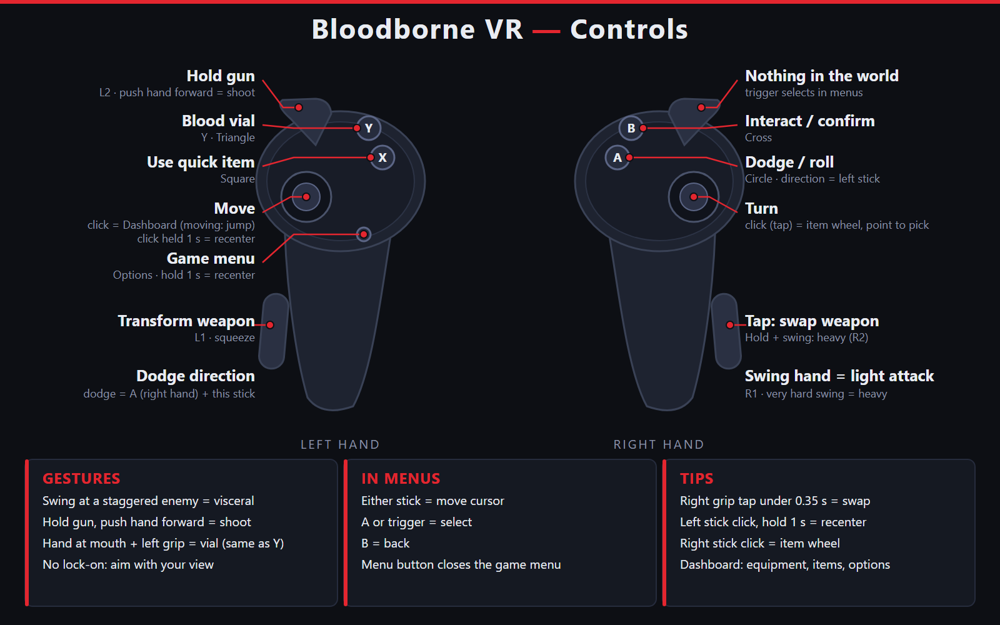

# Bloodborne VR (alpha)

Play your own copy of **Bloodborne** (PS4, CUSA03173, version 1.09) in VR on Windows. The game's
own PS4 x86-64 code runs natively on a shadPS4-derived Vulkan renderer; an OpenXR bridge adds
stereo rendering, head tracking, first-person view, controller-driven arms and weapons, and VR
menus.

> **Alpha, single-player only.** Expect bugs and comfort issues.
>
> **No game files are included.** You need your own legally obtained, decrypted dump. This is an
> unofficial fan project, not affiliated with, endorsed or sponsored by Sony Interactive
> Entertainment, FromSoftware or any trademark holder. PlayStation, PS4 and Bloodborne are
> trademarks of their owners.

## Play (testers)

**Download `BloodborneVR-<version>-Setup.exe` from Releases, run it** (SmartScreen: the alpha is not
code-signed, so click **More info, then Run anyway**), then **Start menu, Bloodborne VR, choose your
game folder, START VR**. It installs for your user only (no admin rights); uninstalling keeps your
saves and settings. The same release has `BloodborneVR-<version>.zip`, the portable option: unzip it
anywhere with write access and double-click `BloodborneVR.exe`. The zip's `README.txt` has the install
steps, known issues and how to report bugs. The controls are summarised below.

## Controls

| Controller input | In game |
|---|---|
| Left stick | Move |
| Right stick | Camera / turn (smooth or snap, see the Comfort tab) |
| Right-hand swing | Light attack (R1) |
| Swing with the right grip held, or a very hard swing | Heavy attack (R2); keep the grip held after the swing to charge |
| Quick right-grip tap (under 0.35 s, no swing) | Swap the right-hand weapon |
| Right trigger | Nothing in the world |
| Left trigger (hold) | Hold the gun (L2) |
| Left-hand thrust forward (gun held) | Shoot |
| Left grip (squeeze) | L1 (transform) |
| A / B / X / Y | Circle (dodge, sprint) / Cross (interact) / Square (use quick item) / Triangle (blood vial; also left hand at your mouth with the left grip held) |
| Right stick click (tap) | Open the item wheel: pick with your right hand (touch or point) or the stick |
| Left stick click while standing | Open the VR dashboard (equipment, items, options) |
| Left stick click while moving | Jump |
| Left stick click, held 1 s | Recenter |
| Left menu button | Options (pause); held 1 s: recenter |
| Swing at a staggered enemy | Visceral attack (stagger one with a gun parry, or a charged heavy from behind) |

Lock-on is off by default: a right stick click opens the item wheel instead.

**In the game's own menus** (Options, pause): either stick moves the cursor (hold to repeat), **A or either
trigger** confirms, **B** goes back, and the menu button closes the menu.

## Physical items

* Pick an item on the item wheel: it appears in your hand as a simple marker. Squeeze that hand's grip within 5 s to hold it; letting go without using it puts it back.
* **Vials, pills and other drinkables:** bring it to your mouth to use it.
* **Weapon buffs (paper, oil):** rub it along the blade with the other hand (the one without a weapon).
* **Molotovs, throwing knives and the like:** swing and let go of the grip to throw; the throw is aimed from your hand.
* Hits with your weapon and bounces off walls give a haptic pulse in the controller.
* The grey hand markers and the gun laser are off by default.

## Updating (keep your saves)

* **Setup.exe:** run the new `BloodborneVR-<version>-Setup.exe`; it installs over the old version. Your saves and settings (`%LOCALAPPDATA%\BloodborneVR\user`) are kept, and uninstalling keeps them too.
* **Zip:** extract the new zip into a new folder, then copy the old folder's `user\` folder (and `bbvr_config.json` if it exists) into it. You can also extract the new zip over the old folder (your `user\` folder is not part of the zip, so it stays). Optional: copy `out\` too to skip the first-start data build.
* **From the zip to Setup.exe:** copy the zip folder's `user\savedata` to `%LOCALAPPDATA%\BloodborneVR\user\` (create the folder if needed) before the first start of the installed version.

## What works (see `docs/vr/`)

First-person camera with head tracking, true stereo (alternate-eye and renderer stereo), arm IK
and weapons that follow the controllers, comfort dash and turning, stamina and swing feedback,
hit-shape scaling, VR menus (quick wheel, inventory, weapon wheel), hand-thrown goods in the
sandbox. Research notes and design documents are in `docs/vr/findings/`.

Setting: **Hitboxes** (dashboard, Combat): *Big* (default) enlarges your weapon's hit shapes, *Original* keeps the game's own; enemies are never changed.

## Build from source (Windows)

1. Install MSYS2 and open the **CLANG64** shell. Packages: `packaging/windows/README.md`.
2. `git clone --recursive <this repo>`, then `bash build.sh`
   (outputs in `out/`: `bb-probe.exe`, `bb-gpu-capabilities.exe`, `bbport_xr.dll`).
   `build.sh` also applies the patch series in `gpu/patches/fsr-vulkan/` to the `gpu/third_party/fsr-vulkan`
   submodule (needed; the submodules are pinned in this repository). The DLSS bridge source is in `gpu/dlss_bridge/` (MIT); it is built separately
   against NVIDIA's DLSS SDK (not included). The binary release ships the built `bbport_dlss.dll` and NVIDIA's
   `nvngx_dlss.dll` (see `THIRD_PARTY_NOTICES.md`).
3. Run with your own dump:
   `BB_GAME_DIR=/c/games/CUSA03173 python run.py` (flat) or see `tools/release/zip/bbvr_launcher.py`
   for the VR environment variables.
4. Package: `python tools/release/make_release.py` (needs the build output; run
   `python tools/release/export_public.py` first, the packager reads its output).

Unit tests are `EXCLUDE_FROM_ALL` targets in `gpu/CMakeLists.txt` and `gpu/xr_bridge/`.

## Help and bugs

Use the issue templates. Attach `logs/bbvr-latest.log` and never post saves or game files.
If the game crashes a report is saved on your PC and never sent automatically (`docs/CRASH_REPORTS.md`). Contributing: `CONTRIBUTING.md`.

## Licence

GPL-2.0-or-later (`LICENSE`); binary releases are GPLv3 because they bundle Apache-2.0 and
GPLv3 libraries (`COPYING.GPL-3.0`, `THIRD_PARTY_NOTICES.md`).

## Credits

Built on [bbport](https://github.com/deadinside28/bloodborne_pc) by deadinside28, the Windows port
by [Supermedo](https://github.com/Supermedo), the [shadPS4](https://github.com/shadps4-emu/shadPS4)
emulator, community patches by illusion, Kyo and others, FSR-Vulkan (FireBurn), Dear ImGui,
LibAtrac9, and the OpenXR / Khronos projects.
